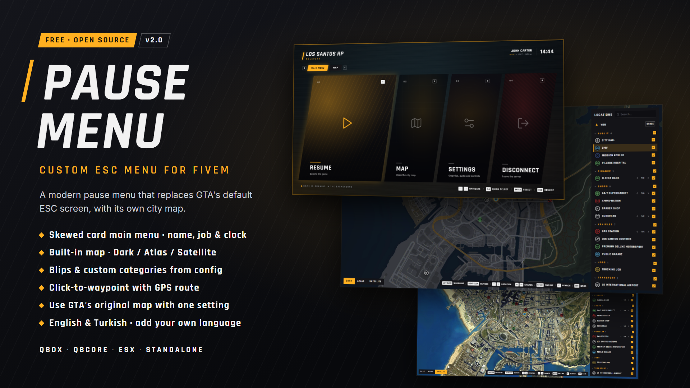
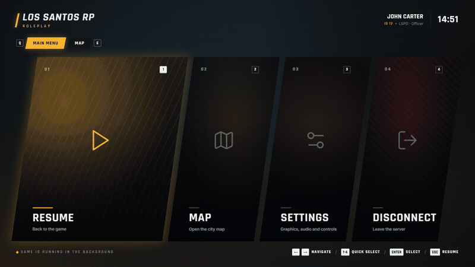
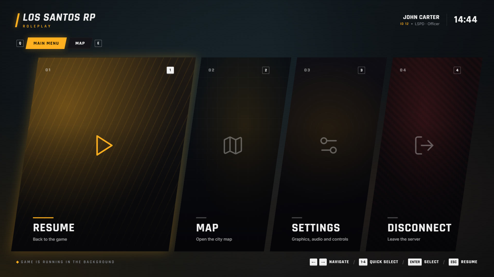
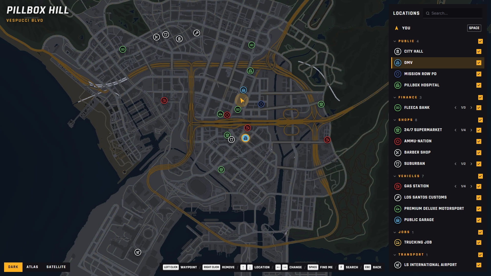
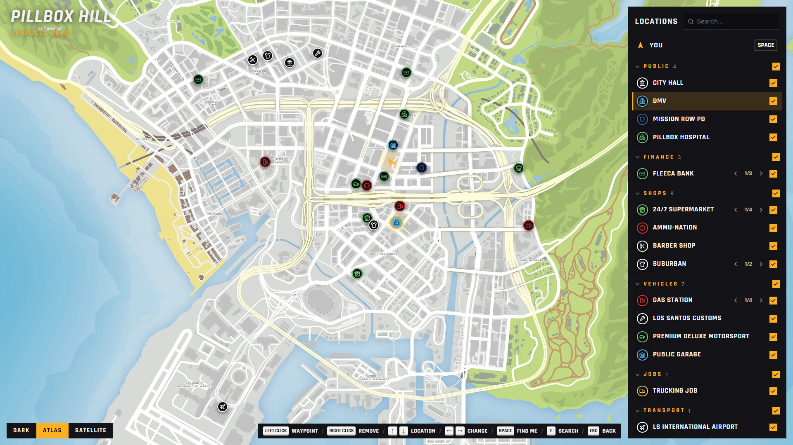
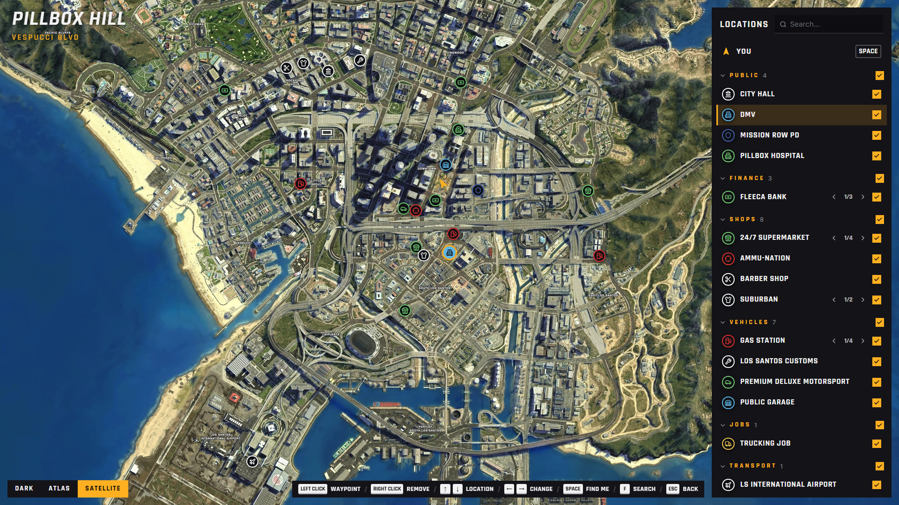
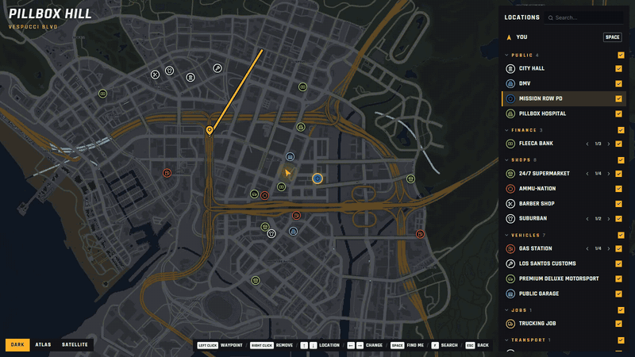

<div align="center">



# MetaDev Pause Menu

**A modern ESC menu for FiveM that replaces GTA's default pause screen, with its own city map.**


**QBox** · **QBCore** · **ESX** · **Standalone**  ·  English · Türkçe

[Features](#features) · [Installation](#installation) · [Configuration](#configuration) · [Map blips](#map-blips) · [Controls](#controls) · [Upgrading from 1.x](#upgrading-from-1x) · [Development](#development)

</div>

<br>

<p align="center">
  
</p>

## Features

### Main menu
- Opens with **ESC** or **P**; GTA's own pause menu is blocked
- Four skewed cards: **Resume** · **Map** · **Settings** · **Disconnect** (asks for confirmation first)
- Header with character name, server ID, job · grade and a clock
  - QBox / QBCore: charinfo + job grade · ESX: first/last name + grade label · Standalone: FiveM player name
- **Settings** opens GTA's original settings screen (graphics, audio, controls, keybinds…); closing it returns to the game

### Map
- Full-screen city map with three styles: **Dark** (matches the menu) · **Atlas** · **Satellite**. Each player's choice is saved on their own PC
- Blips come from `config.lua` (`Config.MapBlips`): name, category, icon and color per place
- **Locations** panel: search, show/hide whole categories or single places, and `◀ 1/4 ▶` paging when several places share a name (nearest first)
- **Custom categories**: use the built-in ones or write any category name you like
- Live zone and street name, and a player arrow that shows heading
- Left-click to set a waypoint, right-click to remove it; the GPS route is drawn on the map
- Prefer GTA's map? Set `Config.EnableMap = false` and the Map card opens GTA's original pause map

### General
- Framework is detected automatically
- Every text lives in `locales/*.json`; add a language without rebuilding the UI
- Fully open source (MIT), nothing is encrypted

## Screenshots

| Main menu | Map (Dark) |
|---|---|
|  |  |
| **Map (Atlas)** | **Map (Satellite)** |
|  |  |

<p align="center">
  
</p>

> Screenshots are from the browser preview with sample data.

## Installation

1. Download the resource and put the `metadev-pausemenu` folder in your server's `resources` folder.
   Leave out `web/node_modules` if it's there; you don't need it and it's large.
2. Add it to `server.cfg` **after** your framework (qbx_core / qb-core / es_extended):
   ```cfg
   ensure metadev-pausemenu
   ```
3. Edit `config.lua` (server name, blips…) and restart.

`web/dist` ships prebuilt, so you don't need Node.js to run it.
Map images are in `web/dist/tiles` (~25 MB; players download them once on first join). If you set `Config.EnableMap = false`, you can delete that folder.

## Configuration

Everything is in `config.lua`.

| Option | Description |
|---|---|
| `Config.Locale` | `'en'` · `'tr'`. Any file in `locales/` works, e.g. `'de'` for `locales/de.json` |
| `Config.Framework` | `'auto'` (recommended) · `'qbox'` · `'qb'` · `'esx'` · `'standalone'` |
| `Config.ServerName` / `ServerTagline` | Server name and subtitle in the top left |
| `Config.AccentColor` | Accent color (hex). Every amber tone in the UI comes from here |
| `Config.DefaultTheme` | Menu theme for every player (color, scanlines, animations, blur, UI size) and the default map style |
| `Config.DisconnectMessage` | Message shown on disconnect (a locale key or plain text) |
| `Config.Cards` | Card titles/subtitles (locale keys or plain text); `image` lets you use your own picture |
| `Config.EnableMap` | `true` = the menu's own map · `false` = no map in the menu; the Map card / key open GTA's original map |
| `Config.MapKeybind` | Key that opens the map directly (empty = no default key; players can bind it in FiveM's key settings) |
| `Config.MapBlips` | Places shown on the map, see [Map blips](#map-blips) |

## Map blips

Only the places in `Config.MapBlips` appear on the map (in-game blips are not read). One line per place:

```lua
Config.MapBlips = {
    { label = 'Mission Row PD',   category = 'public',      icon = 'shield', color = 29, x = 425.1, y = -979.5 },
    { label = '24/7 Supermarket', category = 'shops',       icon = 'store',  color = 2,  x = 25.7,  y = -1347.3 },
    { label = 'Vanilla Unicorn',  category = 'Nightlife',   icon = 'music',  color = 27, x = 128.0, y = -1298.0 },
}
```
The coordinates above are examples; use the places on your own server.

| Field | Description |
|---|---|
| `label` | Place name, shown exactly as written. Places with the same label are paged with `◀ 1/2 ▶` |
| `category` | A built-in category or **any text** (see below). Places with the same category are grouped together |
| `icon` | One of the icon names below. Unknown names show a pin |
| `color` | GTA blip color id ([color list](https://docs.fivem.net/docs/game-references/blips/#blip-colors)) |
| `x`, `y` | Game coordinates (`z` isn't needed) |

**Categories.** These built-in names are translated into the menu language and listed in this order:
`public` · `finance` · `shops` · `vehicle` · `jobs` · `fun` · `transport` · `property` · `crime` · `other`

Any other text (e.g. `'Nightlife'`) becomes its own category, shown as written. Empty = `other`.

<details>
<summary><b>Blip icons</b> (click to expand)</summary>

<br>

The icons come from [Lucide](https://lucide.dev/icons/). `icon` must be one of these names:

| `icon` | Lucide icon | `icon` | Lucide icon | `icon` | Lucide icon |
|---|---|---|---|---|---|
| `shield` | [shield](https://lucide.dev/icons/shield) | `hospital` | [hospital](https://lucide.dev/icons/hospital) | `flame` | [flame](https://lucide.dev/icons/flame) |
| `landmark` | [landmark](https://lucide.dev/icons/landmark) | `banknote` | [banknote](https://lucide.dev/icons/banknote) | `store` | [store](https://lucide.dev/icons/store) |
| `shirt` | [shirt](https://lucide.dev/icons/shirt) | `scissors` | [scissors](https://lucide.dev/icons/scissors) | `pen` | [pen](https://lucide.dev/icons/pen) |
| `crosshair` | [crosshair](https://lucide.dev/icons/crosshair) | `drama` | [drama](https://lucide.dev/icons/drama) | `book` | [book](https://lucide.dev/icons/book) |
| `fuel` | [fuel](https://lucide.dev/icons/fuel) | `warehouse` | [warehouse](https://lucide.dev/icons/warehouse) | `wrench` | [wrench](https://lucide.dev/icons/wrench) |
| `droplets` | [droplets](https://lucide.dev/icons/droplets) | `car` | [car](https://lucide.dev/icons/car) | `truck` | [truck](https://lucide.dev/icons/truck) |
| `trash` | [trash-2](https://lucide.dev/icons/trash-2) | `bus` | [bus](https://lucide.dev/icons/bus) | `car-taxi` | [car-taxi-front](https://lucide.dev/icons/car-taxi-front) |
| `target` | [target](https://lucide.dev/icons/target) | `briefcase` | [briefcase](https://lucide.dev/icons/briefcase) | `laptop` | [laptop](https://lucide.dev/icons/laptop) |
| `beer` | [beer](https://lucide.dev/icons/beer) | `music` | [music](https://lucide.dev/icons/music) | `film` | [film](https://lucide.dev/icons/film) |
| `mic` | [mic](https://lucide.dev/icons/mic) | `flag` | [flag](https://lucide.dev/icons/flag) | `dumbbell` | [dumbbell](https://lucide.dev/icons/dumbbell) |
| `camera` | [camera](https://lucide.dev/icons/camera) | `plane` | [plane](https://lucide.dev/icons/plane) | `helicopter` | [plane](https://lucide.dev/icons/plane) (same as `plane`) |
| `anchor` | [anchor](https://lucide.dev/icons/anchor) | `home` | [house](https://lucide.dev/icons/house) | `building` | [building-2](https://lucide.dev/icons/building-2) |
| `leaf` | [leaf](https://lucide.dev/icons/leaf) | `pill` | [pill](https://lucide.dev/icons/pill) | `package` | [package](https://lucide.dev/icons/package) |
| `key` | [key-round](https://lucide.dev/icons/key-round) | `pin` | [map-pin](https://lucide.dev/icons/map-pin) | `info` | [info](https://lucide.dev/icons/info) |
| `dice` | [dices](https://lucide.dev/icons/dices) | `fish` | [fish](https://lucide.dev/icons/fish) | `pickaxe` | [pickaxe](https://lucide.dev/icons/pickaxe) |
| `utensils` | [utensils](https://lucide.dev/icons/utensils) | `coffee` | [coffee](https://lucide.dev/icons/coffee) | `gem` | [gem](https://lucide.dev/icons/gem) |

To use another Lucide icon, import it in `web/src/map/icons.ts`, add a key for it to `ICONS`, and rebuild the UI (`npm run build`).

</details>

## Languages

Every text in the menu, both Lua and UI, is in `locales/<code>.json`. To add a language:

1. Copy `locales/en.json` to e.g. `locales/de.json` and translate the values (keep the keys).
2. Set `"_lang"` to the language tag (e.g. `"de-DE"`). It's used for sorting and upper/lower case rules.
3. Set `Config.Locale = 'de'`.

Missing keys fall back to English, so a partial translation still works. No UI rebuild needed.

`Config.Cards` and `Config.DisconnectMessage` accept either a locale key (`'card.resume'`) or plain text.

## Controls

| Key | Main menu | Map |
|---|---|---|
| `Q` / `E` | Switch tab | Switch tab |
| `←` `→` | Select card | Next/previous place with the same name |
| `↑` `↓` | Select card | Select location |
| `1`–`4` | Go to / select card | — |
| `ENTER` | Select | Waypoint to the selected place |
| `SPACE` | Select | Find me |
| `F` | — | Focus search |
| Left / right click | — | Set / remove waypoint |
| `PgUp` / `PgDn` | — | Zoom in / out |
| `ESC` | Close menu | Back to main menu |

## Upgrading from 1.x

<details>
<summary>2.0 changes <code>config.lua</code>. Click for the full list.</summary>

<br>

**Start from the new `config.lua`** and copy your own values into it. Replace the whole resource folder so no removed file is left behind.

**Removed**
- **Settings screen** (GTA settings rows, live settings, Keybinds and Theme tabs). The Settings card now opens GTA's original settings screen. Removed files: `client/settings.lua`, `client/keybinds.lua`
- **Automatic map blips** (in-game blips and blip names learned from other resources). Removed files: `shared/blips.lua`, `server/blipnames.lua`, `server/scanner.lua`
- `Config.AutoKeybinds`
- Per-player theme choices: the theme now always comes from `Config.DefaultTheme`. Only the map style is still chosen by the player on the map

**Renamed / changed**

| 1.x | 2.0 |
|---|---|
| `Config.Locations` | `Config.MapBlips` (the old name is no longer read) |
| `label = 'loc.city_hall'` | `label = 'City Hall'` (plain text, shown as written) |
| `category = 'cat.shops'` | `category = 'shops'` (`'cat.shops'` still works). Any other text is a custom category |

**Added**
- `Config.EnableMap`: `false` hides the menu's map; the Map card and `Config.MapKeybind` open GTA's original map

Old per-player data saved by 1.x is deleted automatically when 2.0 starts.

</details>

## Development

The UI is React 18 + TypeScript + Vite + Tailwind CSS 3 + Leaflet. You only need this if you change files in `web/src`.

```bash
cd web
npm install
npm run dev     # browser preview with sample data: http://localhost:5173  (add ?lang=tr for Turkish)
npm run build   # rebuilds web/dist
```

- Use Tailwind **v3** (v4 doesn't work in FiveM). Don't use `backdrop-filter` / `filter: blur` / `drop-shadow` / `mix-blend-mode`.
- UI texts are read with `t('key')` from `web/src/i18n.ts`. In game the dictionary comes from Lua; the browser preview imports `locales/*.json` directly.
- Coordinate conversion (`web/src/map/crs.ts`): `pixelX = 3755.5 + 0.66·x`, `pixelY = 5524.5 − 0.66·y` (8192 px image, checked against 6 known points).
- The dark map style is generated from the atlas tiles with `web/scripts/recolor-dark-tiles.cjs` (run `npm install sharp` first; it isn't a project dependency).
- After installing or changing the resource, run through the [in-game test checklist](docs/TESTING.md).

## Credits

- Map images: [VIRUXE/gtav-map-tiles](https://github.com/VIRUXE/gtav-map-tiles) (images © Rockstar Games)
- Icons: [Lucide](https://lucide.dev) · Map engine: [Leaflet](https://leafletjs.com) · Fonts: [Inter](https://github.com/rsms/inter), [Rajdhani](https://github.com/itfoundry/rajdhani)

## License

Released under the [MIT License](LICENSE). Third-party fonts, libraries and map images keep their own licenses; see [THIRD_PARTY_NOTICES.md](THIRD_PARTY_NOTICES.md).
